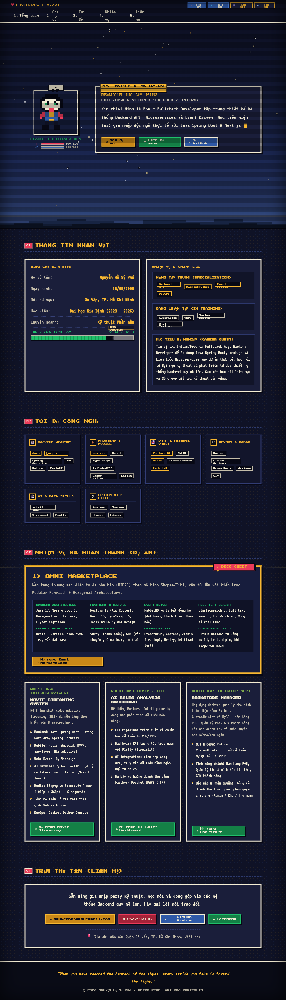

# Nguyễn Hồ Sỹ Phú | 8-Bit Pixel RPG Portfolio 🎮

> Portfolio cá nhân phong cách Pixel Art Retro 8-bit RPG của **Nguyễn Hồ Sỹ Phú** (Fullstack Developer - Fresher / Intern).



## 🌟 Điểm nổi bật
- **Giao diện Retro 8-Bit**: Thiết kế bảng màu và typography chuẩn phong cách game cổ điển (Fonts: `Press Start 2P`, `VT323`).
- **Interactive UI**: Hiệu ứng âm thanh 8-bit retro, thanh trạng thái nhân vật (HP/MP/EXP), túi đồ (Inventory / Tech Stack), danh sách nhiệm vụ (Quest Log / Projects).
- **Responsive & Tối ưu**: Thuần HTML5, CSS3 và Vanilla JavaScript, không phụ thuộc framework nặng, tải nhanh tức thì.

## 🚀 Live Demo
- **GitHub Pages**: [https://nhsphu.github.io/PortfolioPx/](https://nhsphu.github.io/PortfolioPx/)

## 📂 Cấu trúc thư mục
```
├── index.html       # Trang chính cho GitHub Pages
├── code.html        # File mã nguồn gốc
├── screen.png       # Ảnh chụp màn hình preview
└── README.md        # Giới thiệu dự án
```

## 💻 Chạy cục bộ (Local)
Chỉ cần mở trực tiếp file `index.html` bằng bất kỳ trình duyệt nào hoặc dùng Live Server trong VS Code:
```bash
# Hoặc dùng Python http.server
python -m http.server 8000
```
Truy cập `http://localhost:8000`.

---
*Created with ❤️ by Nguyễn Hồ Sỹ Phú*
